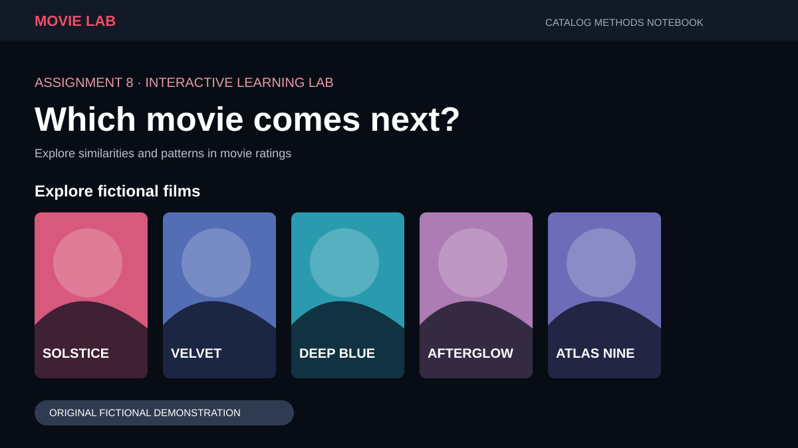
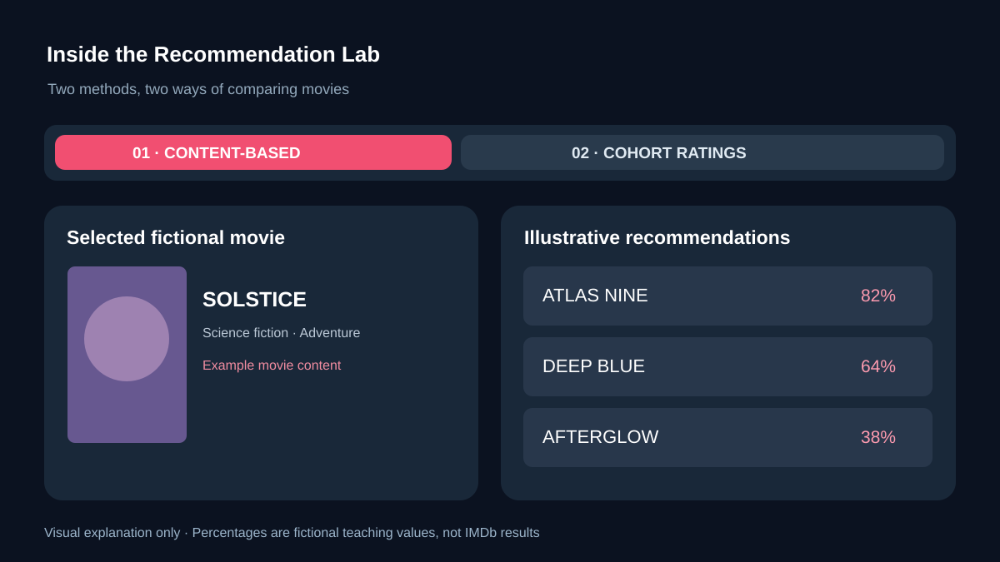
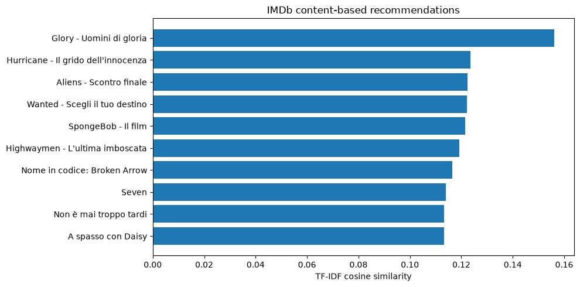
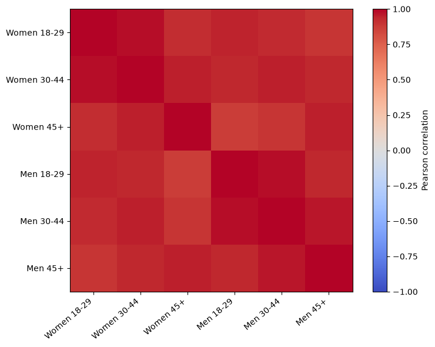

<div align="center">

# Movie Recommendation Systems | Assignment 8

**Juan Luna Santibanez**

Miami Dade College | CAI2100C-2267-6908 | Machine Learning Foundations

**Professor Beth Muturi**

**Goal:** Build and compare content-based and collaborative movie recommendation systems using the IMDb Extensive dataset. The main notebook includes executed results and visualizations.

  

[**Google Colab**](https://colab.research.google.com/github/SupaHumano/CAI2100C-Movie-Recommendation-Systems/blob/main/notebooks/Assignment_8_Movie_Recommendation_Systems.ipynb) · [**Jupyter Notebook**](notebooks/Assignment_8_Movie_Recommendation_Systems.ipynb) · [**IMDb Dataset**](https://www.kaggle.com/datasets/stefanoleone992/imdb-extensive-dataset) · [**Interactive Demo**](https://supahumano.github.io/CAI2100C-Movie-Recommendation-Systems/)

</div>


[](https://supahumano.github.io/CAI2100C-Movie-Recommendation-Systems/)

---

[Overview](#overview) · [Task 1](#task-1-content-based-recommendations) · [Task 2](#task-2-collaborative-recommendations) · [Interactive Demo](#interactive-demo) · [Run](#run-the-notebook) · [Files](#project-files) · [References](#references)

## Overview

In this assignment, I explore two approaches to movie recommendations. One compares what movies are about, while the other uses patterns in ratings. I use the **IMDb Extensive Dataset** referenced in the course assignment and keep the examples from our classroom notebook separate.

My Jupyter notebook includes the code, executed result tables, and two charts using IMDb Extensive records. I also built an interactive teaching example to illustrate the two approaches. The example uses fictional films and is separate from my real-data experiment.


## Task 1: Content-Based Recommendations

I compare movies using their descriptions, genres, directors, and actors. **TF-IDF** converts the text into numerical features, and **cosine similarity** finds titles with related content. The similarity score does not represent someone's personal rating.


## Task 2: Collaborative Recommendations

Collaborative filtering normally uses patterns in audience ratings. The IMDb Extensive dataset provides average ratings for **audience cohorts**, rather than individual viewer histories. I use a cohort-level collaborative approximation to compare those patterns without claiming that it predicts what one person would choose.


## Interactive Demo

The [movie recommendation lab](https://supahumano.github.io/CAI2100C-Movie-Recommendation-Systems/) lets me switch between content-based and cohort-rating examples. I designed it with a cinematic movie catalog, selectable titles, and visual recommendation cards. **All demo movie titles and scores are fictional.** The notebook has already been executed on IMDb Extensive CSV files; the demo does not reuse those real recommendation scores.



## Results from IMDb Extensive

I executed the two assignment tasks using the IMDb Extensive movie and ratings files: **85,855 movie records and 85,855 aggregate-rating records**. For a manageable notebook run, I analyzed the **3,000 most-voted eligible titles**.

**Task 1: Content-based filtering.** TF-IDF and cosine similarity produced movie recommendations using genres, descriptions, directors, and actors.



**Task 2: Cohort-level collaborative approximation.** The dataset gives age/gender-group average ratings instead of individual users' rating histories. I compared six cohort patterns with Pearson correlation, then held out 2,700 observed averages to measure estimation error: **MAE 0.1836** and **RMSE 0.2477**, on the 1–10 rating scale. These values measure *aggregate cohort averages*, not accuracy for predicting an individual viewer's choices.



The [executed notebook](notebooks/Assignment_8_Movie_Recommendation_Systems.ipynb) contains the full tables, Python calculations and charts. The source dataset and the exact file checksums are recorded in [Data Provenance](docs/IMDb_DATA_PROVENANCE.json).

## Optional Classroom Example

I also practiced both methods using the separate MovieLens/TMDB files supplied in class. These real classroom results are recorded separately in [Classroom Data Verification](docs/CLASSROOM_DATA_VERIFICATION.md), together with a [reproducible classroom notebook](notebooks/Assignment_8_Classroom_Data_Verification.ipynb). Those CSVs are not the IMDb Extensive files required by the final tasks, and the results are not represented as IMDb Extensive results.

## Run the Notebook

### Google Colab

[Open the notebook in Google Colab](https://colab.research.google.com/github/SupaHumano/CAI2100C-Movie-Recommendation-Systems/blob/main/notebooks/Assignment_8_Movie_Recommendation_Systems.ipynb), upload **IMDb movies.csv** and **IMDb ratings.csv** from [Kaggle](https://www.kaggle.com/datasets/stefanoleone992/imdb-extensive-dataset), and select **Runtime → Run all** to reproduce the already saved results.

### Kaggle

Open [Kaggle Code](https://www.kaggle.com/code), import the notebook, and attach the [IMDb Extensive dataset](https://www.kaggle.com/datasets/stefanoleone992/imdb-extensive-dataset). This project does not claim that a separate Kaggle notebook is already published.

### Local Jupyter

```bash
git clone https://github.com/SupaHumano/CAI2100C-Movie-Recommendation-Systems.git
cd CAI2100C-Movie-Recommendation-Systems
python -m pip install -r requirements.txt
jupyter notebook notebooks/Assignment_8_Movie_Recommendation_Systems.ipynb
```

Place the two original IMDb CSV files in the local `data/` folder first.

## What I Learned

Content-based filtering finds related movies from their information. The other method estimates patterns in audience ratings. The results depend on what the dataset contains, so I explain the difference between aggregated cohort averages and individual preferences.

I keep the methods and explanations together so I can reproduce this assignment and review the concepts later.

## Project Files

```text
CAI2100C-Movie-Recommendation-Systems/
├── README.md
├── index.html
├── notebooks/
│   ├── Assignment_8_Movie_Recommendation_Systems.ipynb
│   └── Assignment_8_Classroom_Data_Verification.ipynb
├── src/
│   └── recommenders.py
├── assets/
│   ├── hero.svg
│   ├── methods.svg
│   ├── content.svg
│   ├── collaborative.svg
│   ├── site-preview.svg
│   ├── lab-preview.svg
│   ├── icon.svg
│   ├── imdb-content-recommendations.png
│   ├── imdb-cohort-correlation.png
│   └── posters/ (9 original fictional film posters)
├── data/
│   ├── demo.js
│   └── demo_fictional.json
├── docs/
│   ├── PRESENTATION_GUIDE.md
│   ├── METHODOLOGY.md
│   ├── ASSIGNMENT_REQUIREMENTS.md
│   ├── CLASSROOM_DATA_VERIFICATION.md
│   ├── IMDb_DATA_PROVENANCE.json
│   └── KAGGLE_NOTEBOOK_REFERENCES.md
├── requirements.txt
└── .gitignore
```

## Data Sources and Reproducibility

The [primary notebook](notebooks/Assignment_8_Movie_Recommendation_Systems.ipynb) has been executed on IMDb Extensive CSV files and its charts and result tables are saved. The CSVs are not redistributed in this repository; they can be retrieved from [the Kaggle dataset](https://www.kaggle.com/datasets/stefanoleone992/imdb-extensive-dataset). The recorded run used a [public mirror of that Kaggle dataset](docs/IMDb_DATA_PROVENANCE.json) when direct Kaggle download returned an access error. I documented both file SHA-256 values so the data version can be checked.

The [classroom experiment](notebooks/Assignment_8_Classroom_Data_Verification.ipynb) uses the MovieLens/TMDB CSV files from the instructor's course materials. Its measured results are explained separately in [Classroom Dataset Results](docs/CLASSROOM_DATA_VERIFICATION.md). These source files are not the same as IMDb Extensive.

My [question-and-answer guide](docs/PRESENTATION_GUIDE.md), [methodology](docs/METHODOLOGY.md), and [Kaggle notebook references](docs/KAGGLE_NOTEBOOK_REFERENCES.md) provide the concepts and sources for this assignment.

## References

- Miami Dade College, *Machine Learning Foundations*, Assignment 8, Professor Beth Muturi.
- [Kaggle: IMDb Extensive](https://www.kaggle.com/datasets/stefanoleone992/imdb-extensive-dataset).
- [scikit-learn: TF-IDF](https://scikit-learn.org/stable/modules/generated/sklearn.feature_extraction.text.TfidfVectorizer.html).
- [scikit-learn: Cosine Similarity](https://scikit-learn.org/stable/modules/generated/sklearn.metrics.pairwise.cosine_similarity.html).

---

**Juan Luna Santibanez | Miami Dade College | CAI2100C**