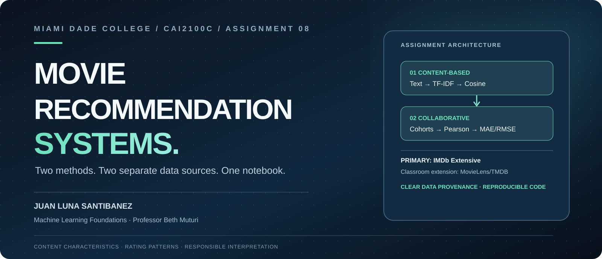

<div align="center">

# Assignment 8 — Movie Recommendation Systems

### CAI2100C · Machine Learning Foundations

**Juan Luna Santibanez**  
**Miami Dade College · Professor Beth Muturi**


**Two assignment tasks. Two IMDb CSV files. One Jupyter notebook.**

[**Open in Google Colab**](https://colab.research.google.com/github/SupaHumano/CAI2100C-Movie-Recommendation-Systems/blob/main/notebooks/Assignment_8_Juan_Luna_Santibanez_Movie_Recommendation_Systems.ipynb) · [**My Jupyter notebook**](notebooks/Assignment_8_Juan_Luna_Santibanez_Movie_Recommendation_Systems.ipynb) · [**IMDb dataset**](https://www.kaggle.com/datasets/stefanoleone992/imdb-extensive-dataset) · [**Interactive learning lab**](https://supahumano.github.io/CAI2100C-Movie-Recommendation-Systems/)

</div>



## Project overview

I completed the two recommendation-system tasks in Professor Muturi's Assignment 8 using records from IMDb Extensive. My project follows the straightforward structure of my [Assignment 7 — K-Means Visualization](https://github.com/SupaHumano/CAI2100C-KMeans-Visualization): **one notebook for the analysis and a separate `data/` directory for CSV inputs**.

My notebook contains the two required methods, explanations, charts, measured results and conclusions. It does **not** paste thousands of movie records inside Python cells.

## The two assigned methods

| Task | My implementation | Result |
|---|---|---|
| **Task 1 — Content-Based Filtering** | Movie descriptions, genres, directors and actors; TF-IDF + cosine similarity | A ranked recommendation table and similarity chart |
| **Task 2 — Collaborative Filtering approach** | Pearson correlation between six IMDb audience-rating cohorts, with holdout evaluation | Group-average predictions, MAE, RMSE and a training-mean baseline |

**Scientific limit:** the public IMDb Extensive rating file provides demographic *group averages*, not individual-user histories. My second approach examines collaborative rating patterns **at cohort level**; I do not claim to have reconstructed personal ratings or implemented user-level SVD.

## Data and reproducibility

I use **two ordinary IMDb CSV files** in `data/`:

- [`IMDb movies.csv`](data/IMDb%20movies.csv) — the complete original IMDb Extensive movie file (85,855 records).
- [`IMDb ratings.csv`](data/IMDb%20ratings.csv) — the complete original IMDb Extensive ratings file (85,855 records).

I use the **full two original IMDb CSV files**; I do not apply a 3,000-title selection or a vote-count cutoff. Task 2 evaluates available cohort ratings with a documented minimum-vote threshold for individual observations.

The notebook's loading cell mirrors Assignment 7: it first checks local project folders. If I open just the notebook in Google Colab, it downloads **only missing CSVs from the same public repository**. When I extract the provided ZIP, both CSVs are already there and the notebook can load them offline.

```python
movies_path = locate_csv("IMDb movies.csv")
ratings_path = locate_csv("IMDb ratings.csv")

imdb_movies_raw = pd.read_csv(movies_path)
imdb_ratings_raw = pd.read_csv(ratings_path)
```

## How to run

### Google Colab

1. [Open my Assignment 8 notebook](https://colab.research.google.com/github/SupaHumano/CAI2100C-Movie-Recommendation-Systems/blob/main/notebooks/Assignment_8_Juan_Luna_Santibanez_Movie_Recommendation_Systems.ipynb).
2. Choose **Runtime → Run all**. The missing CSV files are retrieved from this repository automatically.
3. Review the recommendations, cohort evaluation, plots and conclusions.

### Local Jupyter / VS Code

1. Download the ZIP containing `notebooks/` and `data/`, or clone the repository.
2. Open `notebooks/Assignment_8_Juan_Luna_Santibanez_Movie_Recommendation_Systems.ipynb`.
3. Execute the cells. No Internet connection is needed for data access when the two CSVs are present.

```bash
python -m pip install -r requirements.txt
jupyter notebook notebooks/Assignment_8_Juan_Luna_Santibanez_Movie_Recommendation_Systems.ipynb
```

### Kaggle notebooks

Import the same `.ipynb` into Kaggle Code and provide the CSVs as notebook input files, or enable Internet so the loader can obtain them from the repository. I do not claim to have published a separate Kaggle notebook.

## What I learned

Content-Based Filtering recommends related films based on item characteristics. The cohort-based rating approach examines common patterns in aggregate audience ratings. These methods answer different questions, and I evaluate the latter on held-out group means without treating group averages as individual preferences.

My [interactive website](https://supahumano.github.io/CAI2100C-Movie-Recommendation-Systems/) is a **separate fictional teaching illustration**, not the source of the IMDb research measurements.

## My repository

```text
CAI2100C-Movie-Recommendation-Systems/
├── README.md
├── index.html
├── notebooks/
│   └── Assignment_8_Juan_Luna_Santibanez_Movie_Recommendation_Systems.ipynb
├── data/
│   ├── IMDb movies.csv
│   └── IMDb ratings.csv
├── docs/
│   ├── ASSIGNMENT_REQUIREMENTS.md
│   ├── METHODOLOGY.md
│   └── PRESENTATION_GUIDE.md
├── assets/
└── requirements.txt
```

*The website also has separate fictional demo assets. They are not used for the academic models.*

## Academic references

- Beth Muturi, *CAI2100C Assignment 8 — Movie Recommendation Systems*, Miami Dade College.
- [Stefano Leone, IMDb Extensive dataset](https://www.kaggle.com/datasets/stefanoleone992/imdb-extensive-dataset).
- [scikit-learn, TF-IDF feature extraction](https://scikit-learn.org/stable/modules/generated/sklearn.feature_extraction.text.TfidfVectorizer.html).
- [scikit-learn, pairwise cosine similarity](https://scikit-learn.org/stable/modules/metrics.html#cosine-similarity).

---

<div align="center">

**Juan Luna Santibanez**  
Miami Dade College · CAI2100C · Professor Beth Muturi

</div>
