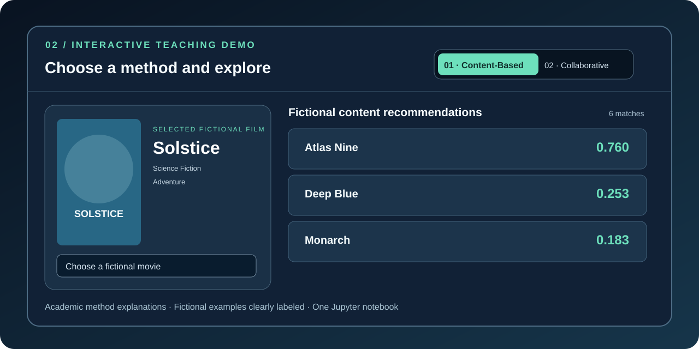

<div align="center">

# Assignment 8 — Movie Recommendation Systems

### CAI2100C · Machine Learning Foundations

**Juan Luna Santibanez**  
**Miami Dade College | Professor Beth Muturi**


**Two tasks. One IMDb source. One notebook.**

[**Google Colab**](https://colab.research.google.com/github/SupaHumano/CAI2100C-Movie-Recommendation-Systems/blob/main/notebooks/Assignment_8_Juan_Luna_Santibanez_Movie_Recommendation_Systems.ipynb) · [**Download Notebook**](notebooks/Assignment_8_Juan_Luna_Santibanez_Movie_Recommendation_Systems.ipynb) · [**IMDb Extensive Dataset**](https://www.kaggle.com/datasets/stefanoleone992/imdb-extensive-dataset) · [**Interactive Educational Demo**](https://supahumano.github.io/CAI2100C-Movie-Recommendation-Systems/)

</div>


---

## My assignment

I implemented the **two tasks stated at the end of Professor Beth Muturi's Assignment 8 notebook**, both using IMDb Extensive.

| Assigned task | My implementation | Evidence in my notebook |
|---|---|---|
| **Task 1 — Content-Based Filtering** | TF-IDF on movie descriptions, genres, directors and actors; cosine similarity | Ranked recommendations and similarity chart |
| **Task 2 — Collaborative Filtering approach** | Pearson correlation between six IMDb demographic rating cohorts | Held-out cohort-average MAE, RMSE, training-group-mean baseline and correlation chart |

**Important methodological limitation:** IMDb Extensive provides **aggregate cohort averages** rather than individual user histories. My second model estimates cohort averages; it is not personalized user-based SVD. I explain the distinction instead of claiming results unsupported by the data.

## Data — already inside the notebook

I embedded **two authentic IMDb research CSV samples**, each with 3,000 rows, **as ordinary human-readable CSV text** in a folded notebook cell:

- `IMDb movies.csv`: 3,000 selected film records
- `IMDb ratings.csv`: 3,000 corresponding records of age/gender audience-rating statistics

I selected these films using a reproducible high-vote criterion. They represent a **selected sample, not every film in IMDb Extensive**. I do not state or imply that I trained on all original IMDb titles.

The notebook loads the included CSV text using **Pandas and `StringIO`**; it does not install downloaders, request credentials, fetch data from the Internet or require separate files. **No compressed payload, encoded dataset block or integrity-hash workflow is used.** The analysis code remains visible, and the data cell can be expanded in any ordinary notebook editor.

## Run my single notebook

### Google Colab

1. [Open my notebook directly in Colab](https://colab.research.google.com/github/SupaHumano/CAI2100C-Movie-Recommendation-Systems/blob/main/notebooks/Assignment_8_Juan_Luna_Santibanez_Movie_Recommendation_Systems.ipynb).
2. Select **Runtime → Run all**.
3. Check the two recommendation tables, charts, cohort correlation and held-out metrics.
4. If needed, download the executed notebook as `.ipynb`.

### Kaggle Code or local Jupyter

Import the **same notebook**. The source data are included, so no dataset attachment is required. For local Jupyter install `requirements.txt` and open the file:

```bash
python -m pip install -r requirements.txt
jupyter notebook notebooks/Assignment_8_Juan_Luna_Santibanez_Movie_Recommendation_Systems.ipynb
```

## Visual presentation



I maintain a separate [interactive educational webpage](https://supahumano.github.io/CAI2100C-Movie-Recommendation-Systems/) with clearly **fictional film titles and scores** to explain how content and rating-pattern recommendation approaches differ. The website is **not** the numerical source for my IMDb model results.

## My oral presentation

My [oral presentation guide](docs/PRESENTATION_GUIDE.md) explains the two models, included CSVs, evaluation methods, limitations, and conclusions. [Methodology](docs/METHODOLOGY.md) and [requirements map](docs/ASSIGNMENT_REQUIREMENTS.md) document the same two-task scope.

## Sources

- Beth Muturi, *CAI2100C Assignment 8 — Movie Recommendation Systems*, Miami Dade College.
- [Stefano Leone — IMDb Extensive Dataset](https://www.kaggle.com/datasets/stefanoleone992/imdb-extensive-dataset).
- [Rounak Banik — Movie Recommender Systems](https://www.kaggle.com/code/rounakbanik/movie-recommender-systems) (classroom method reference).
- [scikit-learn — TF-IDF](https://scikit-learn.org/stable/modules/generated/sklearn.feature_extraction.text.TfidfVectorizer.html).

---

<div align="center">**Juan Luna Santibanez** | Miami Dade College | CAI2100C</div>
